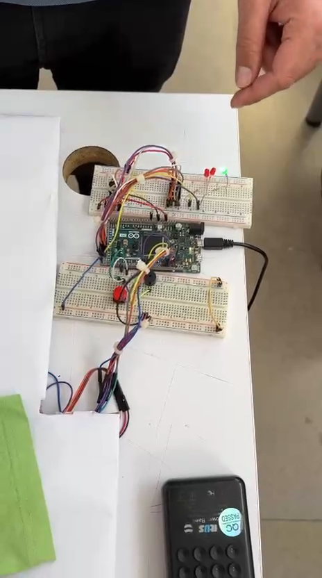

# Automatic Shirt-Folding System: Arduino Due

Academic team project at Shenkar, designed to help people with upper-limb disabilities perform a daily task.

A button starts a five-second countdown followed by a three-stage folding sequence driven by three servos. Red/green LEDs show busy/ready status, and a buzzer signals completion with its PWM duty setting controlled by a potentiometer.

[Watch the demonstration](https://youtube.com/shorts/G_DvAnoztO4)

## Contribution

Matan Ratzabi led most of the development, as confirmed by Matan. The project was submitted with Eden Eli.

## Implementation

- Arduino Due firmware with `Servo` and `SAMDUE_PWM` libraries.
- Falling-edge button interrupt with a 60 ms debounce window and a request flag processed by the main loop.
- Busy-state flag prevents new folding requests during motion.
- Gradual servo-angle steps and attach/detach around each motion reduce idle jitter.
- Common-anode seven-segment countdown display.
- Four-sample, 12-bit ADC reading of the potentiometer mapped to the buzzer PWM duty setting.

## Pin map

| Component | Arduino Due pin |
|---|---|
| Start button | D3, INPUT_PULLUP |
| Servo 1 / 2 / 3 | D12 / D11 / D10 |
| Red / green LED | D26 / D27 |
| Buzzer | D4 |
| Potentiometer | A0 |
| Seven-segment A-G / DP | D30-D36 / D37 |

## Source and setup

The [Arduino sketch](firmware/shirt_folder/shirt_folder.ino) was extracted from the supplied Word document by joining text runs within each paragraph. Only the document title was removed; the control logic was preserved.

Open the sketch in an Arduino IDE configured for Arduino Due and install the `Servo` and `SAMDUE_PWM` libraries. The supplied material does not identify exact library versions. `setup()` waits for a serial connection with `while (!Serial)`, which may need attention for standalone operation depending on the selected port.

The sequence uses blocking delays; this package has not been compiled or tested on hardware. See the [original presentation](docs/presentation.pptx) and [recorded demonstration](media/demo.mp4) for the submitted prototype.

## Team

Matan Ratzabi and Eden Eli. The prototype supports a specific folding surface and calibrated servo angles; no general garment compatibility or user-trial results are claimed.
